<p align="center">
  <picture>
    <source media="(prefers-color-scheme: dark)" srcset="documents/assets/brand/openagentd-banner-dark.webp">
    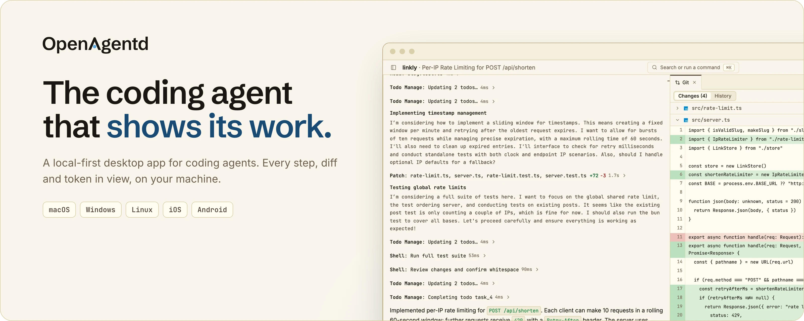
  </picture>
</p>

<p align="center">
  <a href="https://github.com/lthoangg/openagentd/releases/latest"></a>
  <a href="https://github.com/lthoangg/openagentd/releases"></a>
  <a href="LICENSE"></a>
  <a href="https://discord.gg/cz6GQHQUMg"></a>
</p>

<p align="center">
  <a href="https://openagentd.dev">Website</a> ·
  <a href="#install">Install</a> ·
  <a href="#a-quick-tour">Tour</a> ·
  <a href="documents/docs/features.md">Features</a> ·
  <a href="https://discord.gg/cz6GQHQUMg">Discord</a> ·
  <a href="CONTRIBUTING.md">Contribute</a>
</p>

**OpenAgentd is a desktop app for running a coding agent on your own machine.** You give it a folder and a task. It plans, reads, edits, runs your tests, and shows you every step: each tool call with its arguments and timing, every diff, and what each turn costs. You can steer it mid-turn, review its changes before you commit, and use the models and keys you already have.

<picture>
  <source media="(prefers-color-scheme: dark)" srcset="documents/assets/readme/hero-dark.webp">
  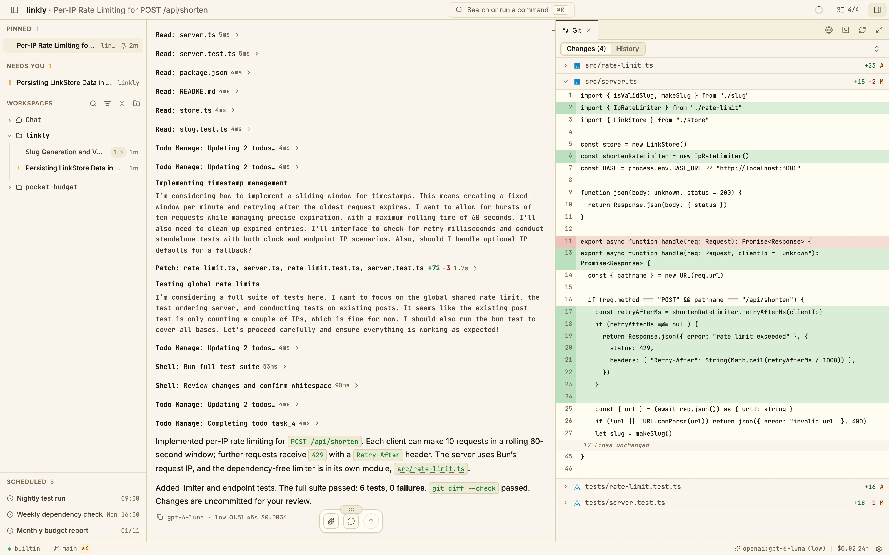
</picture>

<sub>A real session, unedited: the agent added rate limiting to a small Bun service, ran the suite, and left the changes uncommitted for review.</sub>

## Why OpenAgentd

- **Nothing happens off-screen.** Tool calls, reasoning, shell output, file edits, todos, tokens and cost stream into one transcript. Collapse it to just the answers with Reader mode when you only want the result.
- **You decide when code changes.** Plan mode explores read-only and writes a plan you can comment on, then approve. In Code mode you can steer, queue, or stop a running turn.
- **Made for real repositories.** Git changes, history and graph, worktrees, a real terminal, a live preview of your web app, and language-server diagnostics after edits.
- **Your models, your keys.** 18 providers, including Anthropic, OpenAI, Gemini, OpenRouter, Bedrock and DeepSeek, plus your existing ChatGPT, Copilot or Grok subscription, or local models through Ollama.
- **Local-first, and small.** A single native Rust backend (about 43 MB, cold start around 30 ms, about 20 MB idle). Sessions, settings and telemetry stay on your machine. Phones and other computers connect only when you turn on network access.

## Install

**macOS and Linux**

```bash
curl -fsSL https://openagentd.dev/install.sh | sh
```

**Windows** (PowerShell)

```powershell
irm https://openagentd.dev/install.ps1 | iex
```

**Homebrew** (macOS)

```bash
brew install --cask lthoangg/tap/openagentd
```

Open **OpenAgentd**, add a provider in **Settings → Providers** (or point it at Ollama), open a folder and describe what you want built. The desktop app starts its own backend; there is nothing else to run.

Builds for macOS, Windows and Linux are on the [releases page](https://github.com/lthoangg/openagentd/releases/latest). Unsigned builds may ask you to confirm before the first launch.

<details>
<summary><b>iPhone and Android</b></summary>

<br>

The mobile apps connect to OpenAgentd running on your computer. Turn on **Network access** in the desktop app's Backend connection dialog (or run the [CLI server](#cli-server) with `--public --key --qr`), then scan the QR code from the app.

- **iOS** is sideloaded; each release ships an `.ipa`. With [SideStore](https://sidestore.io), add this source to get the app and its updates:

  ```text
  https://github.com/lthoangg/openagentd/releases/download/latest-ios/source.json
  ```

  See [Install the iOS app](mobile/INSTALL-IOS.md) for SideStore setup, other sideloading tools, free Apple Account limits and troubleshooting.

- **Android** 7.0+ (64-bit ARM): install the `OpenAgentd_<version>_Android.apk` from a release. See [Install the Android app](mobile/INSTALL-ANDROID.md).

</details>

<details>
<summary><b>CLI server</b></summary>

<br>

Install only the backend when you want to run it from a terminal, use it from a browser, or serve other devices:

```bash
# macOS / Linux
curl -fsSL https://openagentd.dev/install.sh | sh -s -- --cli
agentd server start
```

```powershell
# Windows PowerShell
& ([scriptblock]::Create((irm https://openagentd.dev/install.ps1))) -Cli
```

The server creates its default agents and configuration on first start and serves the API only: connect to the printed `Server:` address from the desktop app's server connection dialog or the mobile app, then add a provider in Settings.

For a phone or another computer on your network:

```bash
agentd server start --public --key --qr
agentd server status
```

`--public` listens on every interface, `--key` sets the access key every client must send (the server refuses to listen beyond loopback without one), and `--qr` prints a code for the mobile app (`agentd server status --qr` shows it again). There is no built-in TLS, so put an HTTPS reverse proxy in front of it before exposing it outside a trusted network.

Run a single turn in the current folder when you want a pipe-friendly answer:

```bash
agentd run --model openai:gpt-5.5 --thinking high --prompt "Summarize this project"
agentd run --continue --prompt "Now add tests for it"
```

Each run is saved as a session. Use `-C DIR` for another folder, `--continue` or `--session ID` to resume, and `--json` for one JSON line per stream event. Questions from the agent stop a non-interactive run. `agentd --help` lists every command; the older `openagentd` command still works as an alias.

</details>

<details>
<summary><b>Build from source</b></summary>

<br>

Requires a Rust toolchain and [Bun](https://bun.sh):

```bash
git clone https://github.com/lthoangg/openagentd.git
cd openagentd
bun install --cwd web
make dev       # backend on :8000, web UI on http://localhost:5173
```

`make run` starts only the backend. See [CONTRIBUTING.md](CONTRIBUTING.md) for tests and checks.

</details>

## A quick tour

<table>
  <tr>
    <td width="50%" valign="top">
      <picture>
        <source media="(prefers-color-scheme: dark)" srcset="documents/assets/readme/plan-dark.webp">
        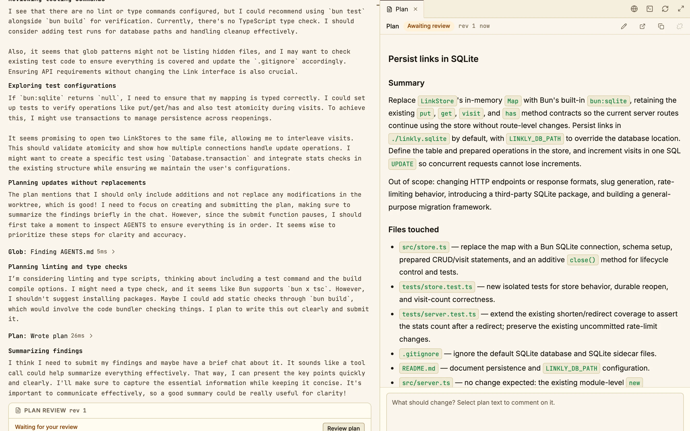
      </picture>
      <h3>Plan first, then build</h3>
      In Plan mode the agent explores without editing and writes a plan. Select any passage to comment on it, then <b>Approve</b> or <b>Request changes</b>. Press <kbd>Tab</kbd> in the composer to switch modes.
    </td>
    <td width="50%" valign="top">
      <picture>
        <source media="(prefers-color-scheme: dark)" srcset="documents/assets/readme/subagents-dark.webp">
        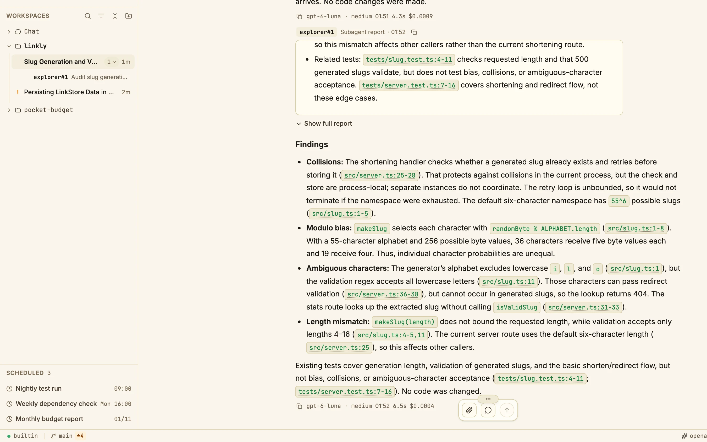
      </picture>
      <h3>Hand work to subagents</h3>
      The lead agent delegates focused jobs to subagents such as <code>explorer#1</code>. Their reports fold into the conversation, and the sidebar shows who is working on what.
    </td>
  </tr>
  <tr>
    <td width="50%" valign="top">
      <picture>
        <source media="(prefers-color-scheme: dark)" srcset="documents/assets/readme/btw-dark.webp">
        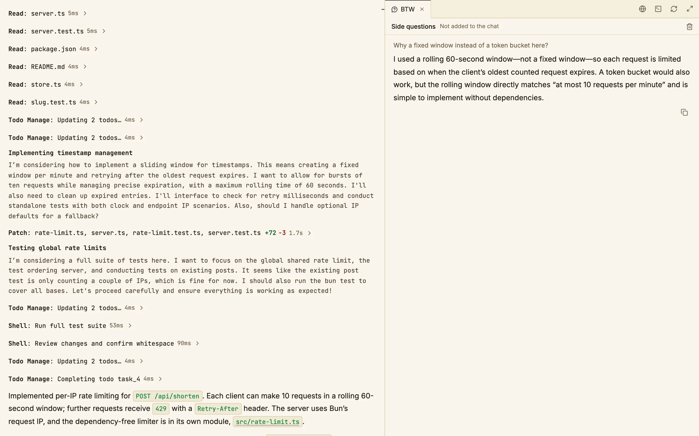
      </picture>
      <h3>Ask on the side</h3>
      <code>/btw</code> answers a quick question from the session's context without adding it to the chat or derailing the turn.
    </td>
    <td width="50%" valign="top">
      <picture>
        <source media="(prefers-color-scheme: dark)" srcset="documents/assets/readme/terminal-dark.webp">
        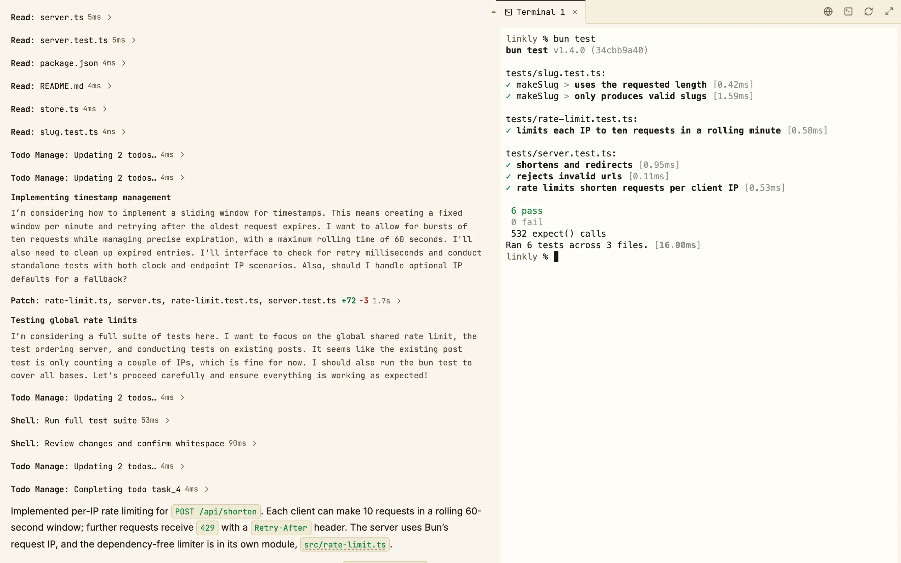
      </picture>
      <h3>A real terminal next to the work</h3>
      Terminals open in the workspace, inside the review dock beside Git, files, preview and the plan. Check the agent's claims yourself.
    </td>
  </tr>
  <tr>
    <td width="50%" valign="top">
      <picture>
        <source media="(prefers-color-scheme: dark)" srcset="documents/assets/readme/palette-dark.webp">
        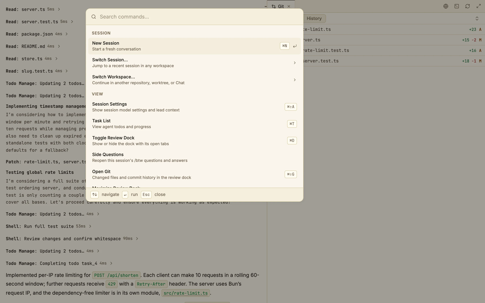
      </picture>
      <h3>Keyboard first</h3>
      <kbd>⌘K</kbd> for commands, <kbd>⌘P</kbd> for files, <kbd>⌘D</kbd> for the dock, <kbd>⌘N</kbd> for a new session. <kbd>⌘/</kbd> lists every shortcut.
    </td>
    <td width="50%" valign="top">
      <picture>
        <source media="(prefers-color-scheme: dark)" srcset="documents/assets/readme/telemetry-dark.webp">
        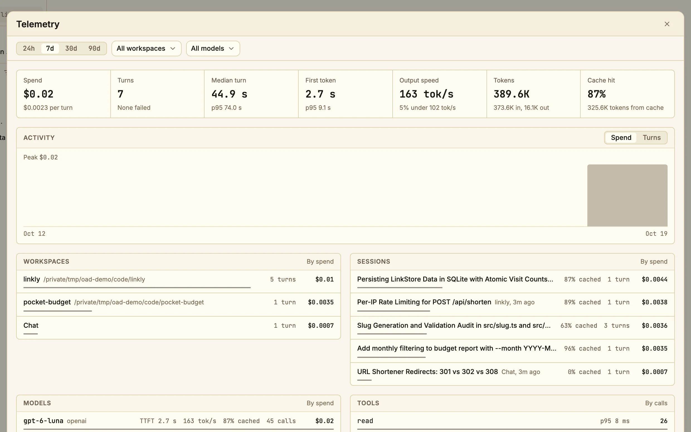
      </picture>
      <h3>Know what it costs</h3>
      Spend, turns, latency, cache hits and tool timings by workspace, model and session. Recorded locally and kept for 90 days.
    </td>
  </tr>
  <tr>
    <td width="50%" valign="top">
      <picture>
        <source media="(prefers-color-scheme: dark)" srcset="documents/assets/readme/providers-dark.webp">
        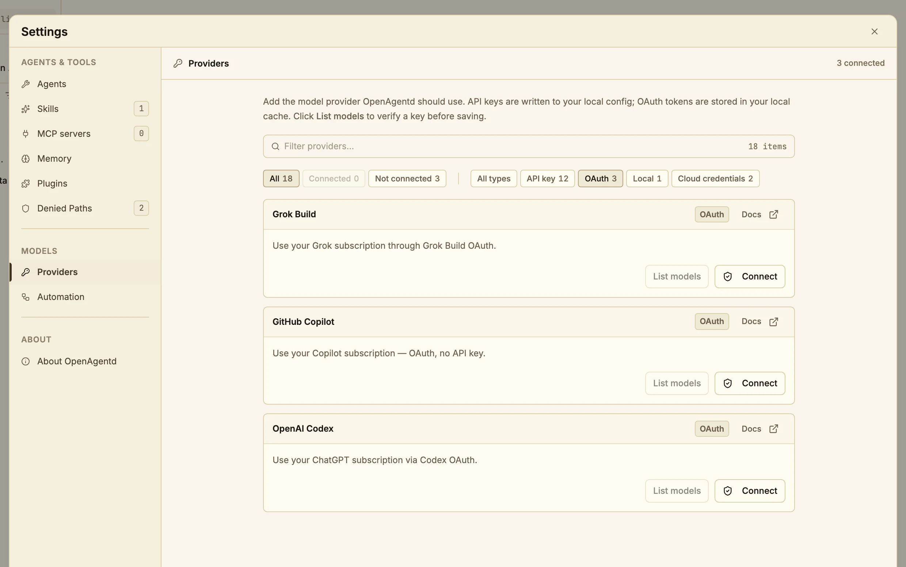
      </picture>
      <h3>Bring your own models</h3>
      API keys, subscription logins (ChatGPT, Copilot, Grok), cloud credentials or local models. Keys are written to your local config.
    </td>
    <td width="50%" valign="top">
      <picture>
        <source media="(prefers-color-scheme: dark)" srcset="documents/assets/readme/new-session-dark.webp">
        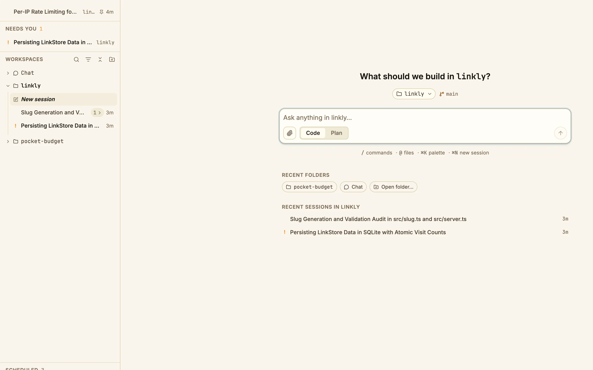
      </picture>
      <h3>Every repo, one window</h3>
      Open any folder, see its branch and recent sessions, and pick Plan or Code. Sessions that need you rise to the top of the sidebar.
    </td>
  </tr>
</table>

<picture>
  <source media="(prefers-color-scheme: dark)" srcset="documents/assets/readme/phone-dark.webp">
  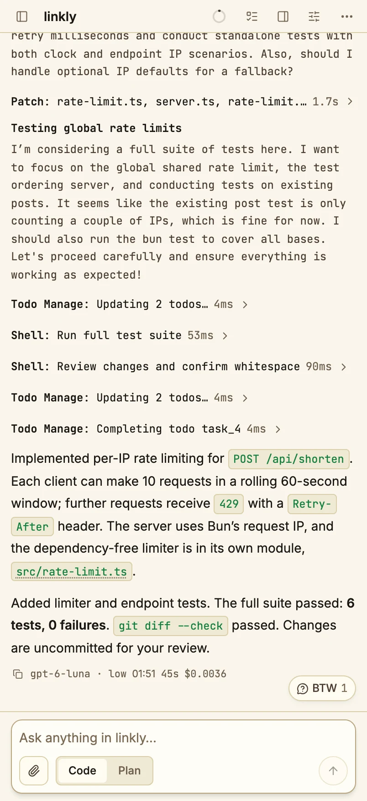
</picture>

### In your pocket

The iOS and Android apps connect to the OpenAgentd running on your computer, so you can check on a long task, answer the agent's questions or review its work from the couch. Same sessions, same agent, nothing in the cloud.

### Make it yours

- **Agents and skills.** Edit agents as Markdown, install skills, and let the lead delegate to members you define.
- **MCP and plugins.** Connect MCP servers, and extend tools and hooks with TypeScript or JavaScript plugins.
- **Memory.** Plain Markdown memory that carries your preferences across sessions.
- **Guardrails.** Denied paths the agent's tools refuse to touch, allow / ask / deny rules per tool, and a shell that never sees your API keys.
- **Schedules.** Run prompts every few minutes, on a cron, or once at a set time.

The [feature catalogue](documents/docs/features.md) lists every shipped capability with the release that introduced it.

<br clear="right">

## Community

- [Discord](https://discord.gg/cz6GQHQUMg) and the [Facebook group](https://www.facebook.com/groups/1256361676707935) for questions and chat.
- [Issues](https://github.com/lthoangg/openagentd/issues) for bugs, requests and roadmap discussion.
- [Releases](https://github.com/lthoangg/openagentd/releases) for builds and release notes.
- [Security policy](SECURITY.md) to report a vulnerability privately.
- [Contributing](CONTRIBUTING.md) to set up a checkout and send changes.

OpenAgentd is open source under the [Apache 2.0 license](LICENSE).
