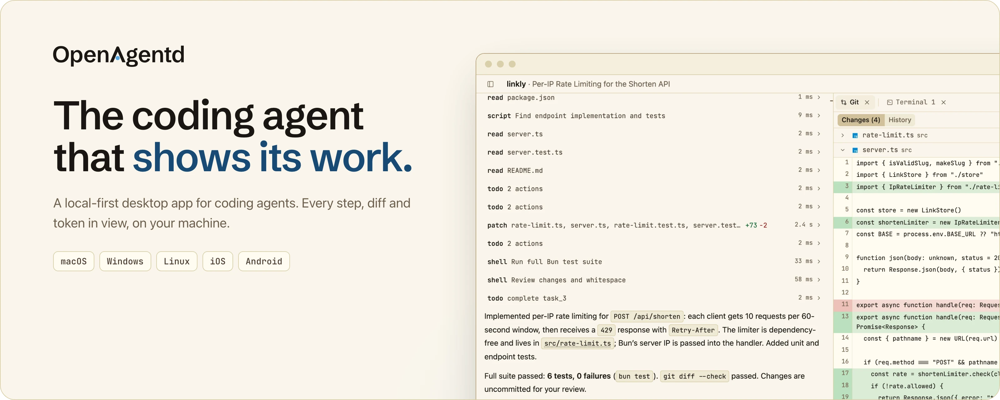
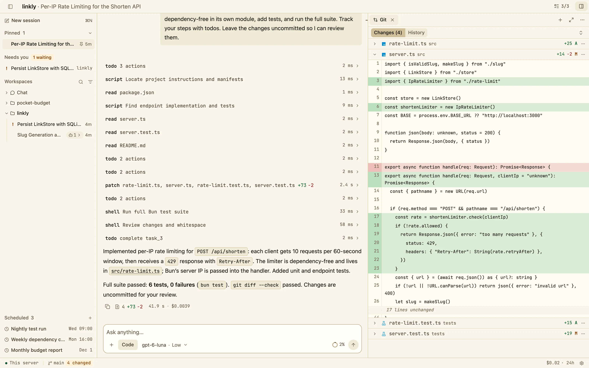
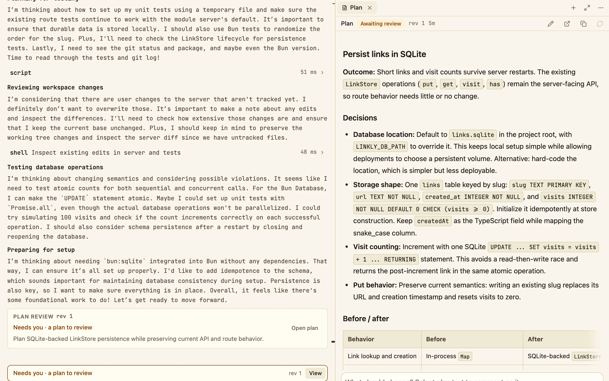
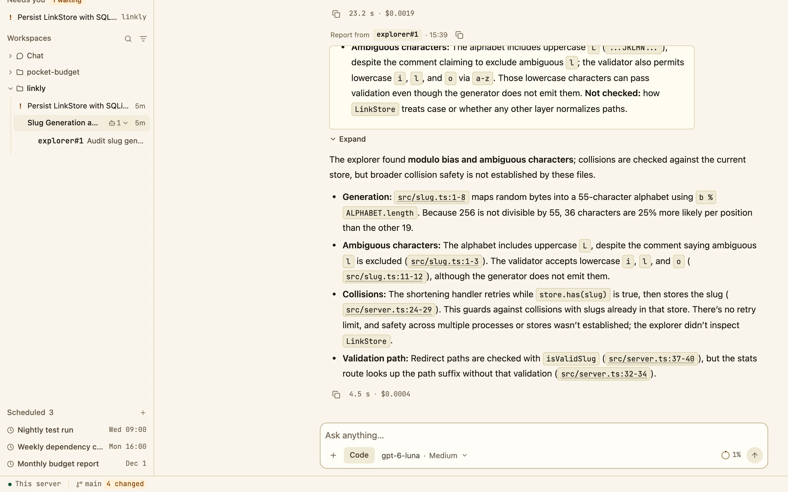
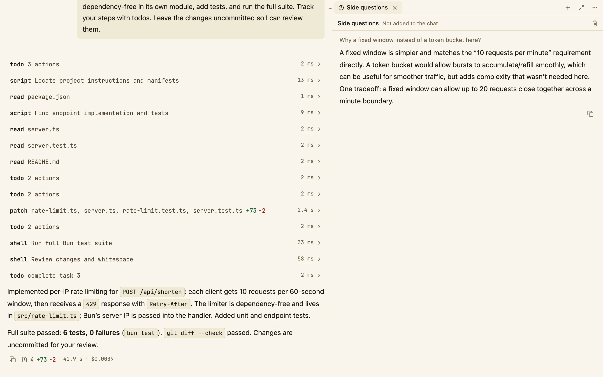
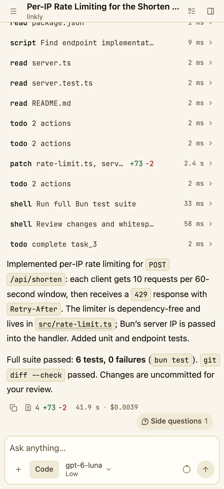

<p align="center">
  <picture>
    <source media="(prefers-color-scheme: dark)" srcset="documents/assets/brand/openagentd-banner-dark.webp">
    
  </picture>
</p>

<p align="center">
  <a href="https://github.com/lthoangg/openagentd/releases/latest"></a>
  <a href="https://github.com/lthoangg/openagentd/releases"></a>
  <a href="LICENSE"></a>
  <a href="https://discord.gg/cz6GQHQUMg"></a>
</p>

<p align="center">
  <a href="https://openagentd.dev">Website</a> ·
  <a href="#install">Install</a> ·
  <a href="#a-quick-tour">Tour</a> ·
  <a href="https://openagentd.dev/features/">Features</a> ·
  <a href="https://discord.gg/cz6GQHQUMg">Discord</a> ·
  <a href="CONTRIBUTING.md">Contribute</a>
</p>

**OpenAgentd is a desktop app for running a coding agent on your own machine.** You give it a folder and a task. It plans, reads, edits, runs your tests, and shows you every step: each tool call with its arguments and timing, every diff, and what each turn costs. You can steer it mid-turn, review its changes before you commit, and use the models and keys you already have.

<picture>
  <source media="(prefers-color-scheme: dark)" srcset="documents/assets/readme/hero-dark.webp">
  
</picture>

<sub>A real session, unedited: the agent added rate limiting to a small Bun service, ran the suite, and left the changes uncommitted for review.</sub>

## Why OpenAgentd

- **Nothing happens off-screen.** Tool calls, reasoning, shell output, file edits, todos, tokens and cost stream into one transcript. Collapse it to just the answers with Reader mode when you only want the result.
- **You decide when code changes.** Plan mode explores read-only and writes a plan you can comment on, then approve. Approve with **Keep going** and the agent works until the plan's *Done when* is proven. In Code mode you can steer, queue, or stop a running turn.
- **Made for real repositories.** Git changes, history and graph, worktrees, a real terminal, a live preview of your web app, and language-server diagnostics after edits.
- **Your models, your keys.** 18 built-in providers: Anthropic, OpenAI, Gemini, OpenRouter, Bedrock, DeepSeek and more, your existing ChatGPT, Copilot or Grok subscription, and local models through Ollama. Plugins can add others. When a task needs an API key, the agent asks for it on a card and uses it without ever seeing it.
- **On your phone too.** The iPhone and Android apps show the same sessions: answer the agent's questions, approve plans and follow its work, over your network or from anywhere with optional remote control.
- **Extend it.** Connect MCP servers, add skills and plugins, generate images and video, and let the agent chain many tool calls in one scripted step.
- **Local-first, and small.** A single native Rust backend: a 46 MB binary that starts in about 50 ms. Sessions, settings and telemetry stay on your machine. Other devices connect only when you turn on network access or sign in to remote control.

## Install

**macOS and Linux**

```bash
curl -fsSL https://openagentd.dev/install.sh | sh
```

**Windows** (PowerShell)

```powershell
irm https://openagentd.dev/install.ps1 | iex
```

**Homebrew** (macOS)

```bash
brew install --cask lthoangg/tap/openagentd
```

Open **OpenAgentd** and connect a model on the first screen: paste an API key, sign in with a ChatGPT or Copilot subscription, or choose **Use** on a key or Ollama install it finds. Then open a folder and describe what you want built. The desktop app starts its own backend; there is nothing else to run. The [setup guide](https://openagentd.dev/download/desktop/) walks through providers and first launch, and builds for every platform are on the [releases page](https://github.com/lthoangg/openagentd/releases/latest). Unsigned builds may ask you to confirm before the first launch.

**iPhone and Android** apps connect to OpenAgentd on your computer. The iPhone and iPad app is on the [App Store](https://apps.apple.com/app/openagentd/id6831600179), with early builds in the public [TestFlight beta](https://testflight.apple.com/join/rykJnzxZ); see the [iOS](https://openagentd.dev/download/ios/) and [Android](https://openagentd.dev/download/android/) guides.

To build from source, see [CONTRIBUTING.md](CONTRIBUTING.md#quick-start).

### CLI server

Install only the backend to run it from a terminal or to serve the apps on your other devices:

```bash
curl -fsSL https://openagentd.dev/install.sh | sh -s -- --cli
agentd server start                       # add --public --key --qr to pair a phone, or --cloud for remote control
agentd run "Summarize this project"
agentd run --continue "Now add tests for it"
```

```powershell
# Windows PowerShell
& ([scriptblock]::Create((irm https://openagentd.dev/install.ps1))) -Cli
```

The server serves the API only: connect to the printed `Server:` address from the desktop or mobile app. There is no built-in TLS, so put an HTTPS reverse proxy in front of it before exposing it outside a trusted network. `agentd --help` lists every command.

## A quick tour

<table>
  <tr>
    <td width="50%" valign="top">
      <picture>
        <source media="(prefers-color-scheme: dark)" srcset="documents/assets/readme/plan-dark.webp">
        
      </picture>
      <h3>Plan first, then build</h3>
      In Plan mode the agent explores without editing and writes a plan. Select any passage to comment on it, then <b>Approve</b> or <b>Request changes</b>. Approve with <b>Keep going</b> and it works until the plan is done. Press <kbd>Tab</kbd> in the composer to switch modes.
    </td>
    <td width="50%" valign="top">
      <picture>
        <source media="(prefers-color-scheme: dark)" srcset="documents/assets/readme/subagents-dark.webp">
        
      </picture>
      <h3>Hand work to subagents</h3>
      The lead agent delegates focused jobs to subagents such as <code>explorer#1</code>. Their reports fold into the conversation, and the sidebar shows who is working on what.
    </td>
  </tr>
  <tr>
    <td width="50%" valign="top">
      <picture>
        <source media="(prefers-color-scheme: dark)" srcset="documents/assets/readme/btw-dark.webp">
        
      </picture>
      <h3>Ask on the side</h3>
      Type <code>/btw</code> to ask about the work without interrupting it. The answer opens in its own panel and never enters the agent's context.
    </td>
    <td width="50%" valign="top">
      <picture>
        <source media="(prefers-color-scheme: dark)" srcset="documents/assets/readme/phone-dark.webp">
        
      </picture>
      <h3>Take it with you</h3>
      Pair a phone by scanning a QR code. It shows the same sessions, rings when the agent needs you, and lets you reply, approve or stop from anywhere.
    </td>
  </tr>
</table>

The [full tour](https://openagentd.dev/features/) covers agent teams, goals, the scheduler, web preview, secrets, plugins, MCP and skills, memory, telemetry and more. The [feature catalogue](documents/docs/features.md) lists every shipped capability with the release that introduced it.

## Community

- [openagentd.dev](https://openagentd.dev) for features, setup guides and downloads.
- [Discord](https://discord.gg/cz6GQHQUMg) and the [Facebook group](https://www.facebook.com/groups/1256361676707935) for questions and chat.
- [Issues](https://github.com/lthoangg/openagentd/issues) for bugs, requests and roadmap discussion.
- [Releases](https://github.com/lthoangg/openagentd/releases) for builds and release notes.
- [Security policy](SECURITY.md) to report a vulnerability privately.
- [Contributing](CONTRIBUTING.md) to set up a checkout and send changes.

OpenAgentd is open source under the [Apache 2.0 license](LICENSE).
